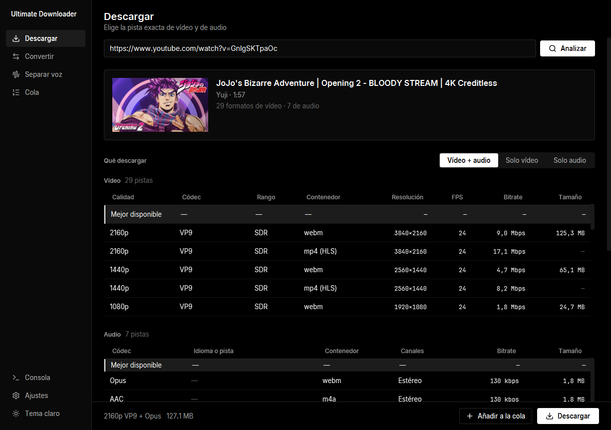
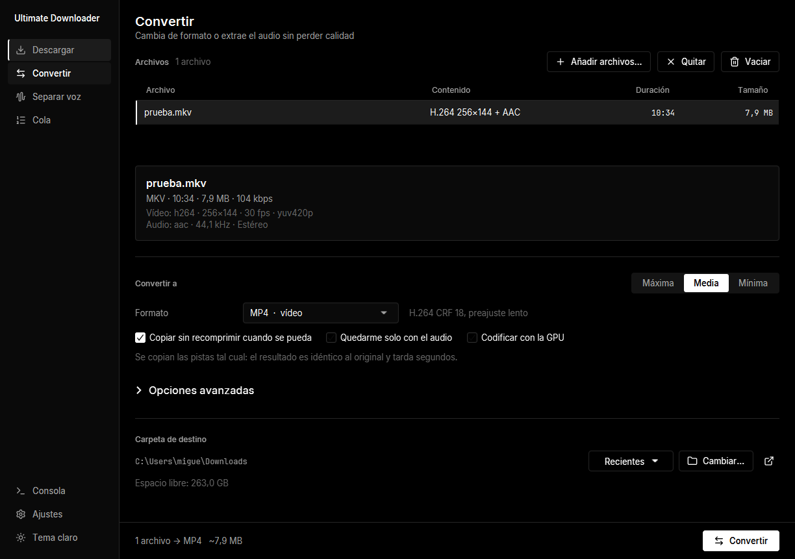
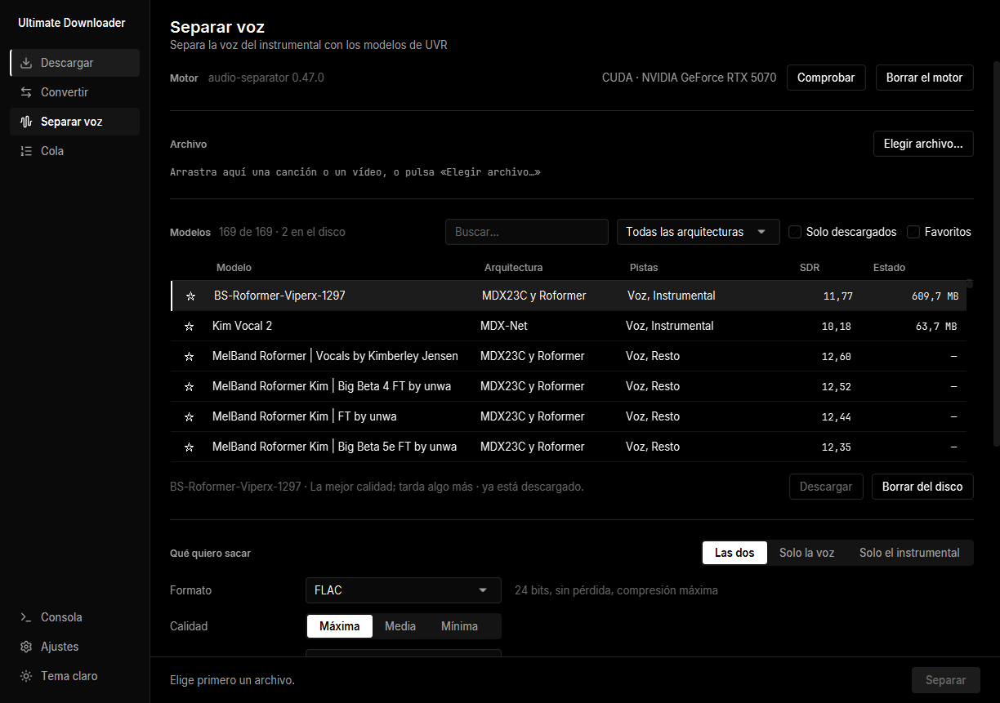
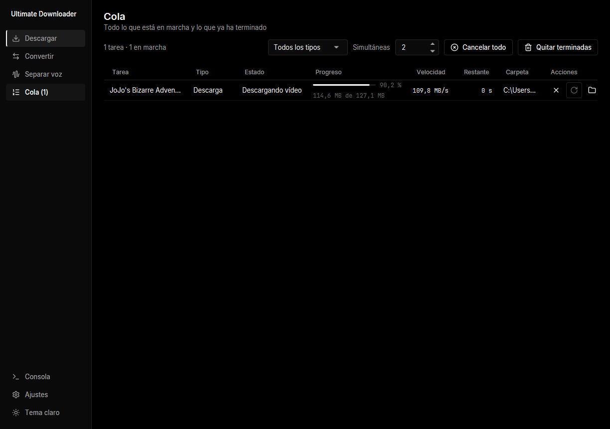
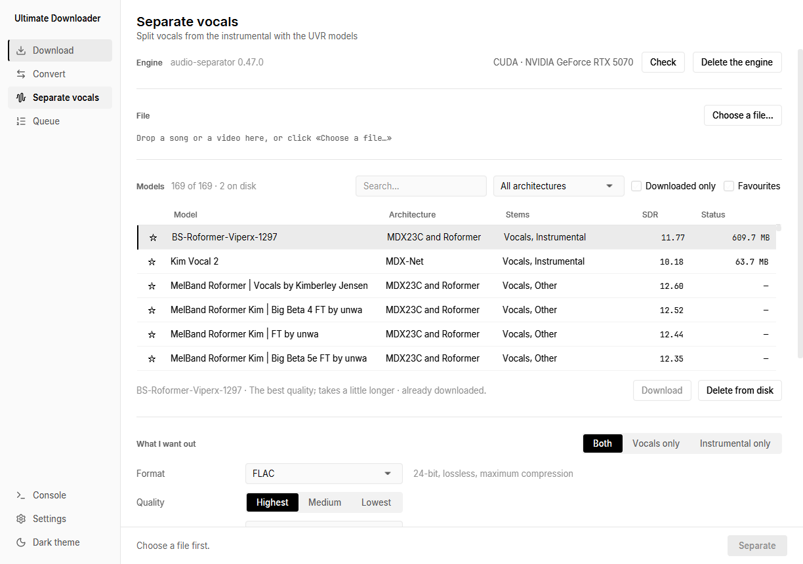

# Ultimate Downloader

Aplicación de escritorio para **Windows, Linux y macOS** con tres herramientas de medios en una:

- **Descargar** vídeos de YouTube **eligiendo la pista exacta de vídeo y de audio**: resolución,
  fps, códec (AV1, VP9, H.264), HDR, bitrate, idioma de la pista y tamaño. Por defecto no
  recomprime nada: solo cambia el envoltorio del archivo.
- **Convertir** entre formatos con ffmpeg, copiando las pistas sin recomprimir cuando se puede.
- **Separar voz** del instrumental con los modelos de UVR, por GPU cuando la hay.

Hecha con Java 21 y JavaFX 21. La interfaz está en ocho idiomas y se cambia desde los ajustes,
sin reiniciar. Cada versión trae su propio instalador y no hace falta tener Java.



---

## Instalación

Pulsa el archivo de tu sistema y empieza la descarga. **No hay nada más que instalar**: cada
paquete lleva dentro su propio Java y también yt-dlp y ffmpeg, así que al terminar la
aplicación funciona sin descargar nada ni configurar nada.

| Sistema | Descarga | Tamaño | Instalar |
|---|---|---|---|
| Windows 10 u 11, 64 bits | [**UltimateDownloader-1.0.0.exe**](https://github.com/migui-dev/ultimate-downloader/releases/download/v1.0.0/UltimateDownloader-1.0.0.exe) | 187 MB | doble clic |
| Linux con glibc (Ubuntu, Debian, Mint…) | [**UltimateDownloader-1.0.0.deb**](https://github.com/migui-dev/ultimate-downloader/releases/download/v1.0.0/UltimateDownloader-1.0.0.deb) | 212 MB | `sudo apt install ./…deb` |
| macOS 11 o posterior, Apple Silicon | [**UltimateDownloader-1.0.0.dmg**](https://github.com/migui-dev/ultimate-downloader/releases/download/v1.0.0/UltimateDownloader-1.0.0.dmg) | 139 MB | abrir y arrastrar |

Están todas en la [página de releases](https://github.com/migui-dev/ultimate-downloader/releases),
por si prefieres mirarlas allí.

Cada versión publica ahí las **sumas SHA-256** de los tres archivos. Si la del que te has
descargado coincide, es exactamente el que salió de la compilación pública y nadie lo ha
tocado por el camino: `certutil -hashfile <archivo> SHA256` en Windows, `shasum -a 256
<archivo>` en Linux y macOS.

Los paquetes llevan además una **atestación de procedencia firmada por GitHub**: la prueba de
que ese archivo lo compiló este repositorio, en este commit y con el workflow que puedes leer.
Se comprueba con la [herramienta oficial de GitHub](https://cli.github.com):

```bash
gh attestation verify UltimateDownloader-1.0.0.exe --repo migui-dev/ultimate-downloader
```

### Windows

Doble clic en el `.exe` y siguiente. Se instala **para tu usuario**, así que no pide permisos
de administrador y deja el acceso en el menú de inicio.

La primera vez Windows enseña un aviso azul de SmartScreen, porque el instalador no está
firmado: **Más información → Ejecutar de todas formas**.

Para desinstalarlo, *Aplicaciones instaladas* → Ultimate Downloader.

### Linux

```bash
sudo apt install ./UltimateDownloader-1.0.0.deb
```

El `./` del principio no sobra: sin él, apt busca un paquete con ese nombre en los
repositorios en vez de instalar el archivo.

Queda en `/opt/ultimate-downloader` y aparece en el menú de aplicaciones como **Ultimate
Downloader**. Si tu distribución usa rpm, el paquete se genera con
`./gradlew instalador -Ptipo=rpm` y se instala con `sudo dnf install ./UltimateDownloader-*.rpm`.

Para desinstalarlo: `sudo apt remove ultimate-downloader` (o `sudo dnf remove`).

### macOS

Abre el `.dmg` y arrastra la aplicación a *Aplicaciones*. Como tampoco está firmada, al
abrirla sale **«Apple no ha podido verificar que Ultimate Downloader no contenga software
malicioso»**. Hay que autorizarla una vez:

1. Pulsa **Aceptar**, nunca «Trasladar a la Papelera».
2. Entra en **Ajustes del Sistema → Privacidad y seguridad** y baja hasta *Seguridad*: hay un
   aviso de que se ha bloqueado la aplicación, con el botón **Abrir igualmente**.
3. Púlsalo, confirma con Touch ID o con tu contraseña, y en el último diálogo, **Abrir**.

Solo la primera vez; después se abre con normalidad. En macOS 15 Sequoia el antiguo atajo de
*clic derecho → Abrir* ya no sirve: Apple lo retiró y obliga a pasar por Ajustes.

La alternativa, desde la terminal, es quitarle la marca de cuarentena:

```bash
xattr -dr com.apple.quarantine "/Applications/Ultimate Downloader.app"
```

### La primera vez que la abras

Nada que preparar: **yt-dlp y ffmpeg vienen dentro del paquete** y la aplicación los usa tal
cual. Si prefieres los que ya tengas instalados, se indica la ruta en Ajustes, y si alguna vez
descargas una versión más nueva a tu carpeta de datos, esa tiene prioridad sobre la incluida.

El módulo de **Separar voz** instala aparte su propio Python la primera vez que entras; son
varios GB y se puede borrar entero desde esa misma pantalla.

---

## Qué hace

### Descargar

- **Analiza un enlace** y muestra la miniatura, el título, el canal y la duración.
- **Tres modos**: vídeo + audio, solo vídeo y solo audio.
- **Todas las pistas de vídeo** en una tabla: calidad, resolución, fps, códec con nombre
  legible, HDR, bitrate, contenedor y tamaño, ordenadas de mejor a peor. «Mejor disponible» es
  la primera fila y viene marcada; coincide con lo que elegiría yt-dlp.
- **Todas las pistas de audio** en otra tabla: bitrate, códec (Opus, AAC), idioma de la pista
  cuando hay varias, canales, contenedor y tamaño.
- **Formato de salida**: MKV, MP4 o WebM para el vídeo (remux sin recomprimir), y original,
  WAV, FLAC, MP3 de 128 a 320 kbps, M4A u Opus para el audio. Si el contenedor elegido no
  admite los códecs seleccionados, avisa y ofrece cambiar de contenedor o recodificar a
  H.264 + AAC, que abre cualquier editor.
- **Subtítulos** por idioma (incluidos los automáticos), miniatura y metadatos incrustados, y
  listas de reproducción completas.
- **Cookies del navegador** (Chrome, Edge, Firefox, Opera, Opera GX, Brave, Vivaldi) para los
  vídeos con restricción de edad.

### Convertir

- Lista de archivos con **arrastrar y soltar**, o con el selector.
- **Ficha de cada archivo** leída con ffprobe: contenedor, duración, bitrate y todas las pistas
  con su códec, resolución, fps, frecuencia, canales y profundidad.
- **Copiar sin recomprimir** cuando el contenedor de destino admite las pistas tal cual: el
  resultado es idéntico al original y tarda segundos. Es lo que se hace por defecto.
- Vídeo a vídeo (MP4, MKV, MOV, WebM, AVI con H.264, H.265, AV1, VP9, ProRes o FFV1), vídeo a
  audio y audio a audio.
- **Opciones avanzadas** cuando hay un solo archivo: resolución, fps, frecuencia de muestreo,
  canales, pista de audio concreta y recorte por tiempo.
- **NVENC** opcional si hay una tarjeta NVIDIA, con el aviso de que la máxima calidad se
  consigue por software.

### Separar voz

- **Motor UVR** a través de [`audio-separator`](https://github.com/nomadkaraoke/python-audio-separator),
  dentro de un **Python propio de la aplicación**: no toca el que tengas instalado, no cambia el
  `PATH` y se puede borrar entero desde la propia pantalla.
- **Asistente de instalación** con barra de progreso y cancelación, que detecta la tarjeta
  gráfica y propone CUDA, DirectML o procesador.
- **Siempre se enseña el dispositivo que se está usando de verdad**, comprobado contra PyTorch
  dentro del entorno, con un aviso explícito si ha caído a procesador y por qué.
- **Catálogo completo de modelos** (169 en cuatro arquitecturas) sacado de la propia
  herramienta: buscador, filtro por arquitectura, favoritos, SDR y espacio que ocupa cada uno.
- **Uno o varios modelos**: por separado, para comparar resultados, o mezclados con el
  *ensemble* nativo (media, mediana, mínimo, máximo, de onda o de espectro, y los dos de UVR).
- **Qué sacar**: las dos pistas, solo la voz o solo el instrumental.
- **Modo muestra**: separar solo N segundos a partir de un segundo concreto, para probar un
  modelo sin esperar a la canción entera.
- **Entrada de vídeo**: se extrae el audio sin remuestrear ni recomprimir, y se puede dejar
  además una copia del vídeo con la pista separada, sin tocar la imagen.
- **Todas las opciones de cada arquitectura** (MDX, VR, Demucs, MDX23C y Roformer) con una
  explicación corta en cada una. Lo que se deja en blanco no se le pasa al motor: manda el
  valor que trae el modelo.
- **Ajustes guardados** con nombre, para repetir una combinación que funcione bien.

### Comunes a los tres módulos

- **Cola única** con progreso, velocidad, tiempo restante, fase y dispositivo, filtro por tipo
  de tarea, cancelación limpia y reintento. Las tareas simultáneas se cambian en caliente.
- **Consola desplegable** (`Ctrl+L`) con la salida en bruto de yt-dlp, ffmpeg y
  audio-separator, coloreada por nivel, con filtro por tarea, búsqueda, copiar, limpiar y
  guardar. Los errores se explican con palabras en la interfaz; el detalle técnico vive aquí.
- **Formato y calidad** definidos en un único sitio del código
  (`model/calidad/Calidades`), iguales en los tres módulos, con el tamaño estimado a la vista.
- **Nunca se inventa calidad**: si el destino supera al origen en resolución, frecuencia,
  profundidad o canales, se avisa de que va a ocupar más y no va a sonar ni verse mejor.
- **Interfaz en ocho idiomas**: español, inglés, francés, portugués, alemán, italiano, ruso y
  polaco, más la opción «Como el sistema». Se cambia en Ajustes y se aplica al momento, sin
  reiniciar. El idioma manda también en el formato de los números: «1,5 GB» en español y
  «1.5 GB» en inglés.
- **Carpeta de destino siempre a la vista**: ruta actual, botón para cambiarla, carpetas
  recientes, espacio libre, comprobación de permisos antes de empezar y botón para abrirla al
  terminar. Nunca se sobrescribe: se añade `(2)`.

| Convertir | Separar voz |
|---|---|
|  |  |

| Cola | Tema claro, en inglés |
|---|---|
|  |  |

---

## Requisitos

### Para usarla

| Sistema | Versiones | Instalador |
|---|---|---|
| Windows | 10 y 11, 64 bits | `.exe`, instalación por usuario |
| Linux | distribuciones con glibc (Ubuntu, Debian, Fedora…) | `.deb` (o `.rpm`) |
| macOS | 11 Big Sur o posterior, Apple Silicon | `.dmg` |

- **No hace falta tener Java**: cada paquete lleva su propio runtime, ya recortado.
- **Tampoco hace falta instalar yt-dlp ni ffmpeg**: los tres binarios (yt-dlp, ffmpeg y
  ffprobe) viajan dentro del paquete, por eso ocupa lo que ocupa. Son los oficiales de yt-dlp
  y, de ffmpeg, las compilaciones estáticas que publica ese mismo proyecto para Windows y
  Linux y las de [ffmpeg-static](https://github.com/eugeneware/ffmpeg-static) para macOS.
  La aplicación los busca por este orden: la ruta que hayas indicado en Ajustes, su carpeta de
  datos (donde van los que se descargue por su cuenta), los que vienen dentro del paquete y,
  por último, el `PATH` del sistema. Así, una versión más nueva descargada después siempre
  gana a la incluida.

Cada sistema guarda sus cosas donde le corresponde:

| Sistema | Carpeta de datos |
|---|---|
| Windows | `%APPDATA%\UltimateDownloader` |
| Linux | `~/.local/share/ultimate-downloader` |
| macOS | `~/Library/Application Support/UltimateDownloader` |

Para **Separar voz**, además:

| Qué | Cuánto |
|---|---|
| Entorno de Python con PyTorch para CUDA | unos 5 GB |
| Entorno de Python sin GPU o con DirectML | unos 2 GB |
| Cada modelo que descargues | entre 50 MB y 700 MB |

No hace falta instalar Python: la aplicación se baja el suyo la primera vez que entras en el
módulo. Se puede borrar entero desde esa misma pantalla.

Con tarjeta **NVIDIA** se instala PyTorch para **CUDA 13**, que es la versión que trae `sm_120`
y, por tanto, la única que funciona con las RTX 50 (Blackwell). Sin NVIDIA, en Windows se
ofrece DirectML, que vale para AMD e Intel; en macOS, PyTorch usa la GPU de Apple sin instalar
nada aparte; y en cualquier sistema queda el procesador, que funciona siempre pero tarda varios
minutos por canción.

La aplicación enseña **siempre el dispositivo que se está usando de verdad**, preguntándoselo a
PyTorch dentro de su propio entorno. Si algo ha caído a procesador sin que lo pidieras, lo dice.

### Para compilarla

- JDK 21 (probado con Temurin 21.0.10). El resto —Gradle, JavaFX y las bibliotecas— lo
  descarga el *wrapper* la primera vez, con las bibliotecas nativas del sistema en el que
  estés.
- Para generar el instalador, además: **WiX Toolset v3** en Windows, `fakeroot` y `binutils`
  en Linux, nada en macOS.

---

## Cómo se usa

**Descargar**: pega el enlace y pulsa **Analizar**; elige el modo y, si quieres, la pista exacta
de vídeo y de audio; comprueba la carpeta de destino y pulsa **Descargar**. Con **Añadir a la
cola** puedes preparar varias descargas y que vayan saliendo solas.

**Convertir**: suelta los archivos sobre la lista, elige formato y calidad y pulsa **Convertir**.
Si la casilla «Copiar sin recomprimir cuando se pueda» está marcada y el destino lo permite, no
se recodifica nada.

**Separar voz**: la primera vez, instala el motor (tarda unos minutos y baja varios GB). Después,
elige el archivo, marca uno o varios modelos de la lista, di si quieres la voz, el instrumental
o las dos, y pulsa **Separar**. Para probar un modelo sin esperar, marca **Separar solo una
muestra**.

En la pantalla **Cola** ves el progreso de todo y, al terminar, puedes abrir la carpeta con el
archivo seleccionado. `Ctrl+L` abre la consola si quieres ver lo que están diciendo las
herramientas.

---

## Ejecutar en desarrollo

```bash
gradlew.bat run
```

Compilar sin ejecutar:

```bash
gradlew.bat build
```

### Opciones de desarrollo

Para revisar la interfaz sin ir pulsando a mano:

```bash
gradlew.bat run -Purl=https://www.youtube.com/watch?v=...   # analiza ese enlace al arrancar
gradlew.bat run -Purl=... -Pdescargar                        # y además lo manda a la cola
gradlew.bat run -Pabrir=convertir                            # abre una pantalla concreta
gradlew.bat run -Parchivos="a.mkv;b.mp4"                     # los carga en el módulo Convertir
gradlew.bat run -Pseparar=cancion.flac                       # lo separa nada más arrancar
gradlew.bat run -Pentorno=C:/tmp/py                          # otra carpeta para el Python propio
gradlew.bat run -Pinstalar                                   # instala el motor sin pulsar nada
gradlew.bat run -Pidioma=en                                  # cambia de idioma en caliente
gradlew.bat run -Pcaptura=captura.png -Psegundos=10          # guarda una captura y cierra
gradlew.bat run -Pventana=1920x1080                          # tamaño de ventana para la captura
```

---

## Generar la versión final

### Versión portable (recomendada)

```bash
gradlew.bat zipPortable
```

Genera:

- `build/dist/Ultimate Downloader/` — carpeta con el ejecutable y el runtime de Java dentro,
  unos **77 MB**. Funciona en un equipo sin Java.
- `build/dist/UltimateDownloader-1.0.0-portable.zip` — la misma carpeta comprimida.

El runtime se recorta con jlink: sin símbolos de depuración, sin cabeceras, sin páginas de
manual, sin los ejecutables del JDK que el lanzador no usa y con las clases comprimidas. Eso
es lo que lo deja en 77 MB en vez de 124 MB.

El entorno de Python del módulo de separación **no** se empaqueta: se instala en la carpeta de
datos la primera vez que se usa, para no meter 5 GB en el instalador.

En Windows, al terminar deja en la raíz del proyecto el acceso directo **Ultimate
Downloader.lnk**, que se rehace en cada empaquetado. Si solo quieres regenerarlo:

```bash
gradlew.bat accesoDirecto
```

Si la aplicación está abierta, el empaquetado **no** toca la versión que ya hay: avisa de que
hay archivos en uso y la deja como estaba, para no dejarla a medias y sin arrancar.

### Instalador

```bash
gradlew.bat instalador     # Windows
./gradlew instalador       # Linux y macOS
```

Cada sistema genera el suyo, porque jpackage solo sabe crear el de la máquina en la que corre:

| Sistema | Resultado | Hace falta |
|---|---|---|
| Windows | `.exe` | WiX Toolset v3 |
| Linux | `.deb` (con `-Ptipo=rpm`, `.rpm`) | `fakeroot` y `binutils` |
| macOS | `.dmg` | nada |

Los tres salen con el mismo nombre, `UltimateDownloader-<versión>.<extensión>`. jpackage lo
sacaría de `--name`, que lleva un espacio, y GitHub lo convierte en un punto al colgarlo de la
release (`Ultimate.Downloader-1.0.0.exe`); por eso la tarea lo renombra al terminar. Dentro,
el programa se sigue llamando **Ultimate Downloader** en el menú, en la ventana y en la lista
de aplicaciones instaladas. El paquete de Debian conserva su nombre interno en minúsculas,
`ultimate-downloader`, porque es lo que exige dpkg y con el que se desinstala.

La tarea `binariosIncluidos` descarga antes yt-dlp, ffmpeg y ffprobe del sistema para el que
se empaqueta y los mete en `app/herramientas`, dentro de la aplicación. Al lanzador se le pasa
`-Dud.herramientas=$APPDIR/herramientas`, que es la forma que tiene jpackage de decirle a la
aplicación dónde ha quedado su propia carpeta en cada sistema. Para volver a la descarga en
caliente bastaría con quitar ese `from` de `prepararJpackage`.

Los tres se construyen solos en GitHub Actions al publicar una etiqueta `v1.2.3`, y quedan
colgados de la *release*: `.github/workflows/publicar.yml`.

Las dependencias del `.deb` se escriben a mano en `build.gradle.kts` (`dependenciasDeb`) en
vez de dejar que las deduzca jpackage, que las saca de la máquina donde compila. Los nombres
cambian entre versiones de Ubuntu —en 24.04 varias pasaron a llamarse `...t64` al cambiar
`time_t` a 64 bits—, así que un paquete construido en una no se instalaba en la otra.
Puestas con alternativas (`libasound2t64 | libasound2`), el mismo `.deb` sirve en todas.

Hace falta además `src/main/installer/linux/control`: la opción `--linux-package-deps` por
sí sola **añade** las dependencias a las que jpackage deduce en lugar de sustituirlas, y
volvía a colarse el nombre con `t64`. Ese archivo es su plantilla del `control` de Debian
sin la parte automática.

jpackage necesita **WiX Toolset v3** para crear instaladores en Windows. Si no está instalado,
la tarea falla con este mensaje:

```
Can not find WiX tools (light.exe, candle.exe)
Download WiX 3.0 or later from https://wixtoolset.org and add it to the PATH.
```

Hay dos formas de resolverlo:

**Sin instalar nada** (no pide permisos de administrador): descarga
[wix314-binaries.zip](https://github.com/wixtoolset/wix3/releases/tag/wix3141rtm), descomprímelo
donde quieras y pasa esa carpeta:

```bash
gradlew.bat instalador -Pwix=C:/ruta/a/wix314
```

**Instalándolo**: [WiX Toolset v3.14](https://github.com/wixtoolset/wix3/releases) (la rama 3.x;
la 4 y la 5 todavía no sirven para jpackage), añadir al `PATH` su carpeta `bin` y abrir una
consola nueva. El instalador pide .NET Framework 3.5 y permisos de administrador.

El instalador se genera en `build/dist` y se instala **por usuario** (sin pedir permisos de
administrador), con acceso directo en el menú de inicio y opción de elegir la carpeta. Instalar
por usuario también permite que `yt-dlp -U` pueda actualizarse solo.

#### Cómo está personalizado el de Windows

El asistente no es el que sale de serie: va en español, con las imágenes de la aplicación y la
licencia delante. jpackage no tiene opciones para casi nada de eso, pero sí deja sustituir las
piezas con las que construye el paquete, que es lo que hay en `src/main/installer/windows`:

| Archivo | Qué es |
|---|---|
| `main.wxs` | la plantilla WiX de jpackage con dos cambios: el idioma del paquete (3082, español) y las dos imágenes del asistente |
| `ShortcutPromptDlg.wxs` | la pantalla de accesos directos sin la casilla del menú Inicio |
| `es-es.wxl` | los textos en español, tanto los de jpackage como los del propio asistente |
| `MsiInstallerStrings_en.wxl` | esos mismos textos de jpackage en inglés, de respaldo, marcados como sustituibles |

La entrada del **menú Inicio se crea siempre**, y es la que hace que la aplicación aparezca
al buscarla en Windows: el buscador indexa el menú Inicio, así que sin ella queda instalada
pero sin forma de encontrarla salvo por su carpeta. El icono del escritorio sigue siendo
opcional. jpackage no deja preguntar solo por uno de los dos (su opción
`--win-shortcut-prompt` pone las dos casillas o ninguna), de ahí la pantalla propia.

Lo demás lo genera la tarea `recursosInstalador` en `build/jpackage-recursos` cada vez que se
empaqueta, en vez de guardarlo hecho en el repositorio:

- **`banner.bmp`** (493×58) y **`lateral.bmp`** (493×312), dibujadas con el icono y la
  tipografía Inter de la aplicación. El asistente escribe su texto en negro encima, así que la
  parte donde escribe se deja clara: en la lateral, la banda negra ocupa los primeros 164 px.
- **`licencia.rtf`**, convertida desde `LICENSE`, que es el único formato que sabe enseñar el
  diálogo de licencia.

Así ninguna de las tres cosas se queda atrás cuando cambien el icono, la tipografía o la
licencia. Para ver el resultado sin instalar nada vale con abrir el `.exe` y cancelar.

Un detalle que conviene no tocar: el `--win-upgrade-uuid` de `build.gradle.kts`. Es el
identificador por el que Windows reconoce que una versión sustituye a la anterior; cambiarlo
deja dos entradas en «Aplicaciones instaladas» a quien ya tuviera la aplicación.

El resto de la personalización son opciones de jpackage y está en la tarea `instalador`: el
icono, los accesos directos, los enlaces de la ficha de «Aplicaciones instaladas» y la
instalación por usuario.

Para volver al asistente de serie, en inglés, basta con quitar `--resource-dir` y los dos
`.wxl`; lo demás sigue funcionando igual.

### Iconos

El de la aplicación está en `img/`: un `icono-<tamaño>.png` por cada tamaño que usan las
ventanas (16, 24, 32, 48, 64, 128 y 256 px), más `icono.ico` para Windows y `icono.icns` para
macOS. En Linux se usa directamente el PNG de 256.

Los de la interfaz son los de [Lucide](https://lucide.dev) (licencia ISC), pasados de SVG a
trazos de JavaFX en `ui/iconos/Lucide.java`. Cada elemento del SVG original se queda en su
propio `SVGPath`, sin concatenar ni reescribir los comandos: juntarlos rompe las coordenadas
relativas y los iconos salen deformados.

---

## Estructura del proyecto

```
src/main/java/com/ultimatedownloader/
├── Launcher.java              punto de entrada (no extiende Application)
├── App.java                   aplicación JavaFX y fábrica de controladores
├── Contexto.java              servicios compartidos
├── model/                     records inmutables, enums y la tarea observable de la cola
│   ├── calidad/               la tabla de formatos y calidades, en un único sitio
│   ├── convert/               MediaInfo, pistas y peticiones de conversión
│   └── separacion/            modelos de UVR, opciones y peticiones de separación
├── service/                   toda la lógica, sin nada de interfaz
│   ├── ProcessRunner          único punto que lanza procesos
│   ├── cola/                  cola común, ejecutores, cancelación y reintentos
│   ├── consola/               registro común de la salida de los procesos
│   ├── descarga/              ejecutor de yt-dlp
│   ├── convert/               ffprobe, decisión de remux, argumentos y progreso de ffmpeg
│   ├── separacion/            entorno de Python, detección de GPU, catálogo de modelos,
│   │                          argumentos y progreso de audio-separator
│   ├── FormatJsonParser, ArgumentBuilder, ProgressParser, ProgressAggregator,
│   │   ContainerCompatibility, SizeEstimator, FolderValidator, FilenameTemplate,
│   │   TemporalesLimpiador, ErrorTranslator
│   ├── BinaryManager          localiza y descarga yt-dlp y ffmpeg
│   ├── Plataforma             lo poco que cambia entre Windows, Linux y macOS
│   └── SettingsService        ajustes en la carpeta de datos
├── viewmodel/                 estado de las pantallas
├── ui/                        controladores, diálogos, temas, iconos y animaciones
│   ├── CarpetaDestinoController  el bloque de destino que comparten los tres módulos
│   ├── SepararModelosController  catálogo de modelos de UVR
│   ├── SepararAvanzadoController opciones avanzadas de separación
│   ├── Controles                 números de un campo y formato de un desplegable
│   └── OpcionesDesarrollo        las propiedades -Dud.* para revisar la interfaz
├── fx/                        EnSegundoPlano: trabajo fuera del hilo de la interfaz
└── util/                      textos legibles y nombres de idiomas

src/main/resources/com/ultimatedownloader/
├── view/      shell.fxml, un FXML por módulo y los bloques que se reutilizan
├── css/       tokens.css (todos los colores) y app.css (los componentes)
├── i18n/      textos.properties (español, base) y uno por idioma
├── fonts/     Inter y JetBrains Mono
├── python/    el guion que comprueba el dispositivo dentro del entorno
└── img/       los PNG del icono por tamaño, icono.ico e icono.icns

src/main/installer/
├── windows/   plantilla WiX, pantalla de accesos directos y textos del instalador
└── linux/     plantilla del «control» del .deb, con sus dependencias (ver «Instalador»)
```

### Dónde guarda sus cosas

Todo va a la carpeta de datos del usuario, que siempre es escribible:

| Sistema | Carpeta |
|---|---|
| Windows | `%APPDATA%\UltimateDownloader` |
| Linux | `~/.local/share/ultimate-downloader` |
| macOS | `~/Library/Application Support/UltimateDownloader` |

| Qué | Dónde |
|---|---|
| Ajustes | `ajustes.json` |
| Ajustes guardados de separación | `presets-separacion.json` |
| Registro | `logs/aplicacion.log` (rota a 5 MB, 10 días) |
| yt-dlp y ffmpeg descargados | `herramientas/` |
| Python propio, uv y paquetes | `python/` |
| Modelos de UVR descargados | `python/modelos/` |

---

## Decisiones de diseño

- **Nunca se construye una orden concatenando cadenas.** Cada argumento es un elemento de la
  lista que recibe `ProcessBuilder`, así que las carpetas con espacios, acentos o símbolos
  llegan intactas.
- **El progreso se lee del formato para máquinas**, no de la barra para humanos: yt-dlp con
  `--progress-template`, ffmpeg con `-progress pipe:1`. audio-separator no tiene ninguno de los
  dos, así que ahí sí se interpretan sus barras, distinguiendo la de la descarga del modelo
  (mide en bytes) de la de la separación (mide en pasadas).
- **La interfaz no se bloquea nunca**: todo lo pesado va en un `Task` o en el `ExecutorService`
  de la cola, y las propiedades observables solo se tocan a través de `Platform.runLater`.
- **Los errores se traducen**: el usuario ve «La tarjeta gráfica se ha quedado sin memoria» con
  la sugerencia de bajar el tamaño de segmento, no un texto en inglés ni una traza de Java. El
  detalle técnico queda en la consola y en el registro.
- **Al cancelar se mata también a los hijos** (yt-dlp lanza ffmpeg) y se borran los temporales:
  los `.part`, las pistas sueltas `.f401.mp4`, la miniatura descargada y el audio extraído para
  separar.
- **Reintento automático** cuando el fallo parece pasajero: YouTube devuelve a veces un 403 en
  la segunda descarga seguida del mismo vídeo.
- **Una sola tabla de calidades** para los tres módulos. Ahí está escrito qué significa Máxima,
  Media y Mínima en cada formato, y de ahí salen tanto los argumentos de ffmpeg como el texto
  que se enseña y el tamaño estimado.
- **FLAC no admite coma flotante de 32 bits**: su máximo práctico son 24 bits enteros. Donde se
  pide «lo mejor posible», Máxima da WAV `pcm_f32le` de 32 bits en coma flotante y FLAC de 24
  bits, y la interfaz lo dice con esas palabras en vez de prometer algo que el formato no puede
  guardar.
- **PyTorch se instala desde el índice de CUDA 13 y no desde el de 12.8**, porque es la versión
  con la que está compilado `onnxruntime-gpu`. Con torch en cu128 y onnxruntime en CUDA 13, los
  modelos MDX y VR no encuentran `cublas64_13.dll` y caen al procesador sin decir nada.
- **`torch`, `torchvision` y `torchaudio` se instalan juntos y del mismo sitio.** `torchvision`
  entra por la puerta de atrás como dependencia de `onnx2torch`; si se queda la rueda de PyPI
  mientras torch viene del índice de CUDA, al cargar un modelo ONNX salta un
  «operator torchvision::nms does not exist».
- **`audioread` se instala aparte.** `audio-separator` lo importa, pero las versiones nuevas de
  `librosa` ya no lo arrastran, así que sin él el motor no llega ni a arrancar.
- **El temporal con el que se alimenta al motor conserva el nombre del original**, en su propia
  carpeta: audio-separator bautiza las pistas de salida con el nombre del archivo que recibe.
- **Los textos salen todos de un sitio.** Los FXML usan la sintaxis `%clave` que resuelve el
  propio `FXMLLoader`, y el código usa `Textos.t(...)`. El fichero base está en español, así
  que una clave que falte en otro idioma sale en español en vez de dejar un hueco o una clave
  suelta en pantalla.
- **Los huecos de los textos van numerados** (`{0}`, `{1}`) en lugar de concatenar trozos: cada
  idioma coloca las palabras donde le conviene, y el singular y el plural los decide el propio
  texto con un `choice`, porque no todos los idiomas los parten por el mismo número.
- **Cambiar de idioma rehace la interfaz entera** en lugar de recorrerla nodo a nodo. Las tareas
  en marcha viven en el contexto, no en las pantallas, así que no se interrumpe nada.
- **El entorno de Python no se puede mover de sitio**: guarda rutas absolutas dentro de
  `pyvenv.cfg` y de sus propios ejecutables. Si la carpeta de datos cambia de nombre, la
  aplicación lo detecta al arrancar —comprueba que el intérprete arranca de verdad, no solo que
  los archivos estén— y ofrece rehacerlo; los modelos descargados se conservan.
- **Se comprueba el dispositivo de verdad**, ejecutando `torch.cuda.is_available()` dentro del
  entorno ya montado. Tener una tarjeta NVIDIA no garantiza que la rueda instalada sepa hablar
  con ella, y es mejor decirlo antes que descubrirlo media hora después.

---

## Cuando YouTube se pone difícil

Dos cosas fallan de vez en cuando y la aplicación las trata sola:

**«Confirma que no eres un robot»** o un vídeo que de pronto no tiene formatos. YouTube rechaza
a veces al reproductor que usa yt-dlp por defecto. Antes de dar el error, la aplicación vuelve
a pedirlo con otros dos: `web_embedded`, que devuelve el catálogo entero y no pierde calidad,
y `android`, que solo da 360p pero contesta casi siempre. Lo mismo al descargar: si falla por
eso, la cola lo reintenta con el siguiente antes de rendirse. En la consola se ve cuál ha
funcionado.

**Las cookies del navegador.** Esto es lo que más confunde, porque el navegador puede estar
elegido en los ajustes y aun así no servir:

| Lo que pasa | Lo que dice la aplicación | Qué hacer |
|---|---|---|
| Chrome o Edge 127 o posterior | «están cifradas» | Usar un archivo cookies.txt |
| El navegador está abierto | «tiene el archivo bloqueado» | Cerrarlo del todo |
| Opera GX, perfil secundario | «no se encuentra el perfil» | Indicar su carpeta |

En **Ajustes → Cookies del navegador** hay un botón **Probar** que lo comprueba de verdad,
haciendo una petición a YouTube, y dice cuál de los tres casos es. Ya no hay que esperar a que
falle una descarga para enterarse.

La opción **Archivo cookies.txt** funciona siempre, también con Chrome: se exporta desde el
navegador con cualquier extensión de las que guardan cookies en formato Netscape, se elige el
archivo en los ajustes y listo. La aplicación comprueba antes de usarlo que tenga cookies de
YouTube y que sean de una sesión iniciada.

---

## Notas legales

Esta aplicación solo sirve para contenido **sin DRM** de los sitios que admite yt-dlp. No
intenta saltarse ninguna protección: si yt-dlp detecta DRM, la descarga se rechaza con un
mensaje claro. Descargar material protegido por derechos de autor sin permiso puede ser ilegal
en tu país y va contra las condiciones de uso de YouTube; úsala solo con contenido propio, de
dominio público o con licencia que lo permita.

## Créditos

- [yt-dlp](https://github.com/yt-dlp/yt-dlp) — descarga y extracción de formatos.
- [ffmpeg](https://ffmpeg.org/) — unión, remux y conversión.
- [audio-separator](https://github.com/nomadkaraoke/python-audio-separator) y los modelos de
  [Ultimate Vocal Remover](https://github.com/Anjok07/ultimatevocalremovergui) — separación.
- [uv](https://github.com/astral-sh/uv) — gestor del entorno de Python.
- [PyTorch](https://pytorch.org/) y [ONNX Runtime](https://onnxruntime.ai/) — inferencia.
- [AtlantaFX](https://github.com/mkpaz/atlantafx) — base estructural de los controles.
- [Lucide](https://lucide.dev) — iconos (licencia ISC).
- [Inter](https://rsms.me/inter/) y [JetBrains Mono](https://www.jetbrains.com/lp/mono/) —
  tipografías (licencia OFL).
- [JNA](https://github.com/java-native-access/jna) — barra de título oscura de Windows.
- [Jackson](https://github.com/FasterXML/jackson), [SLF4J](https://www.slf4j.org/) y
  [Logback](https://logback.qos.ch/).

## Licencia

[MIT](LICENSE). Las herramientas que usa por debajo tienen la suya: yt-dlp (Unlicense), ffmpeg
(GPL en las compilaciones que se descargan) y los modelos de UVR, cada uno con la de su autor.
